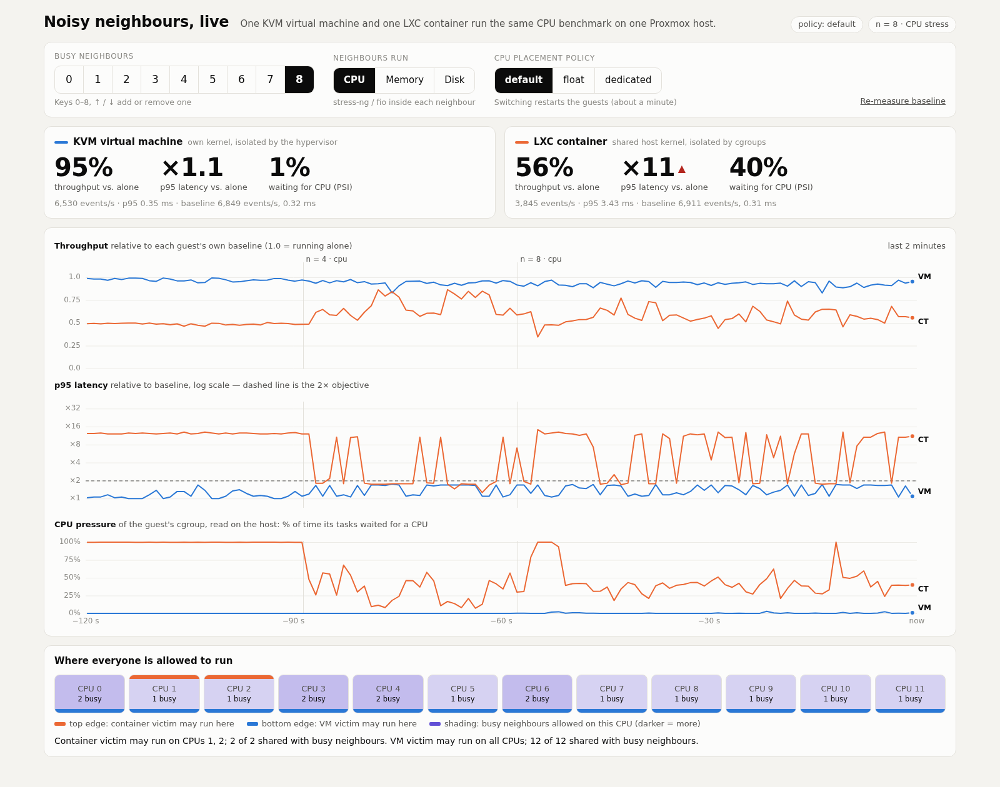
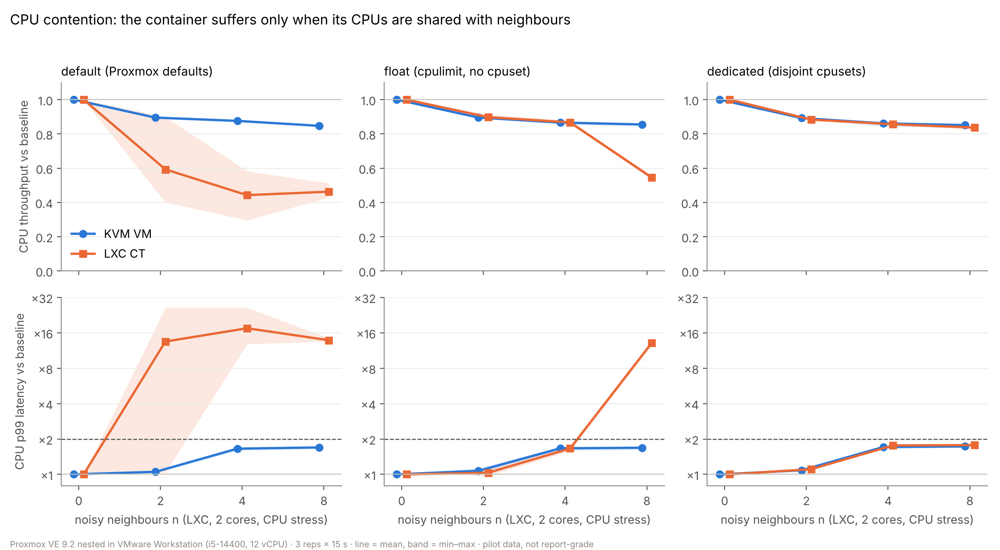
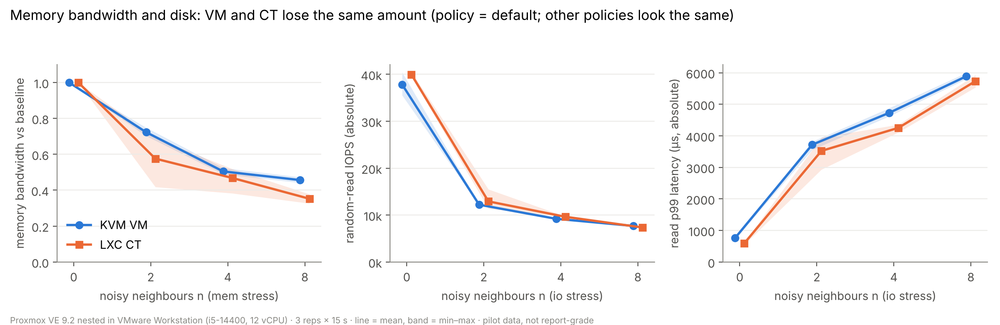
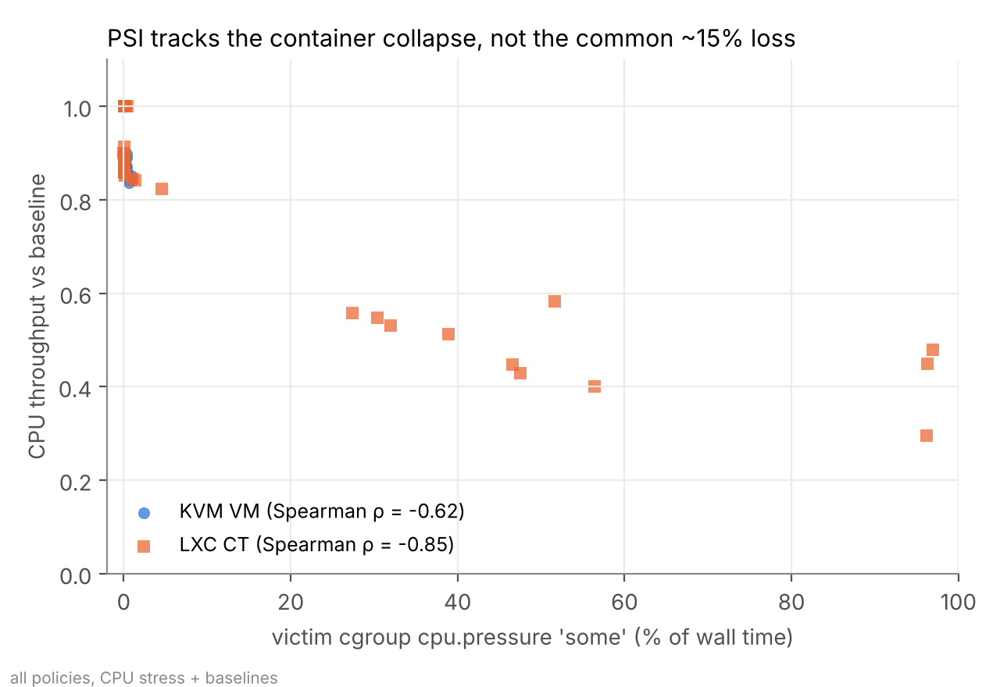

# Noisy Neighbours on Proxmox VE: Performance Isolation of KVM VMs and LXC Containers

Operating Systems term project, National Chung Cheng University, Fall 2026 (two-person team).

We repeat the *competing-workload interference* experiment of Sharma et al. (Middleware 2016) on a current
Proxmox VE stack (kernel 7.0, cgroup v2): one measured guest (a KVM VM or an LXC container) runs next to
n noisy-neighbour LXC containers, and we measure how much its CPU, memory and disk performance degrade.
Slowdowns are explained with host-side kernel counters (cgroup v2 PSI) instead of only being reported.

> **Status (2026-11-13): nested data only.** All results in this repository (the Oct 19 pilot and the
> Nov 12–13 v2 run) come from Proxmox VE running *inside VMware Workstation* (nested virtualisation).
> They are useful for the method and for CPU placement effects, but the VM arm carries an extra
> virtualisation layer and disk results are dominated by the VMware virtual disk. They are **not
> report-grade**; that needs a bare-metal Proxmox host (planned).
>
> 中文說明：[README.zh-TW.md](README.zh-TW.md)

## Project status (2026-11-13)

| Area | State | Notes |
|---|---|---|
| Proposal (2-page abstract, Sep 29) | ✅ done | questions: baseline, isolation under contention, density n* |
| Experiment harness (`osproj.sh`) | ✅ done | builds guests, resumable matrix, only touches its own VMIDs |
| Pilot matrix on nested Proxmox | ✅ done (Oct 19) | 198 configurations, no missing values — `results/nested-2026-10-19/` |
| Pilot analysis + figures | ✅ done | `analysis/`, findings below |
| Nested v2 run (5 reps, n = 1, 2, 4, 8) | ✅ done (Nov 13) | 420 configurations, 0 missing values — `results/nested-v2-2026-11-13/` (+ `REPORT.md`) |
| n = 1 level | ✅ | in the v2 run |
| 5 repetitions | ✅ | in the v2 run; n* now interpolated with a min–max interval |
| Live demo | ✅ run on the nested host (Nov 14) | `demo/` — screenshots in `demo/screenshots/` |
| Bare-metal Proxmox run | ❌ not started | needed for report-grade numbers and for the VM-vs-CT disk question |
| p95 metric | ❌ | the harness records p99 only; n* is defined on p99 |
| Throttling (`cpu.stat`), `io.stat`, VM steal time | ❌ not recorded | the proposal asks which of throttling / pressure / steal explains each slowdown |
| cgroup-hierarchy hypothesis (finding 2) | ⚠️ precondition checked | all `cpu.weight` = 100 (`qemu.slice`, `lxc`, each container, the VM scope); a control run is still needed |
| Comparison table with Sharma et al. 2016 | ❌ | |
| Final report (15 pages, Dec 29) | ❌ not started | |

Deviations from the proposal, to be stated in the report: Debian instead of Ubuntu in the guests, 16 GB instead
of 20 GB disks, the two victims run one at a time, p99 instead of p95 in the pilot, n ∈ {0, 2, 4, 8} and 3
repetitions instead of n ∈ {0, 1, 2, 4, 8} and 5, and three CPU placement policies plus a memory-bandwidth
stress were added. The v2 run uses n ∈ {0, 1, 2, 4, 8} and 5 repetitions; p99 still replaces p95.

## Repository layout

```
osproj.sh                      experiment harness used for all results here (bash, runs on the Proxmox host)
results/nested-2026-10-19/     pilot: raw.csv (long format), summary.csv, placement.tsv (CPU placement log), meta.txt (platform + guest configs)
results/nested-v2-2026-11-13/  v2 run: same files + platform.txt, fig1–3, compare.md (vs pilot), report_stats.md, REPORT.md
analysis/                      load.py + plot.py -> fig1_cpu.png, fig2_mem_io.png, fig3_psi.png;
                               compare.py (two result sets side by side); report_stats.py (numbers used in REPORT.md)
tools/                         switch-hypervisor.{bat,ps1}: toggle the Windows hypervisor so VMware can expose VT-x to Proxmox
demo/                          live demo: web page with neighbour / stress / policy controls (see demo/README.md)
tooling/os-isolation/          alternative Python harness (randomised blocks, 1 Hz sampler, report generator);
                               tested in simulation only, not used for the results above
```

## Experiment (results/nested-2026-10-19)

| Factor | Levels |
|---|---|
| Measured guest | KVM VM (Debian 13 cloud image, 2 vCPU, 2 GB, `cache=none,iothread=1`) · LXC CT (Debian, 2 cores, 2 GB, unprivileged) |
| Neighbours | n = 0, 2, 4, 8 LXC containers (2 cores, 1 GB each) |
| Neighbour stress | CPU (`stress-ng --cpu`), memory bandwidth (`stress-ng --stream`), disk (`fio` 4k randrw QD32 direct) |
| CPU placement policy | `default` (Proxmox defaults) · `float` (`cpulimit`, no cpuset) · `dedicated` (victim and neighbours on disjoint cpusets) |
| Victim benchmarks (15 s each) | `sysbench cpu` (events/s, p99), `sysbench memory` (MiB/s), `fio` 4k randread QD16 direct (IOPS, p99), 1 ms sleep wake-up latency |
| Repetitions | 3, policy order rotated per repetition, stress configurations shuffled, baseline before and drift check after each block |

Host: Proxmox VE 9.2.2 on 12 vCPUs / 16 GB, nested in VMware Workstation 17 on an Intel i5-14400 (Windows 11).

Run it (on the Proxmox host, as root): `bash osproj.sh all` · `bash osproj.sh status` · `bash osproj.sh summary` ·
`bash osproj.sh export <label>` (copies a finished run to `results/<label>-<date>/`) ·
`bash osproj.sh policy <default|float|dedicated>` ·
`bash osproj.sh clean` (destroys only the project's own guests, VMIDs 9100, 9101, 9111–9118, after checking their names).

Reproduce the figures: `pip install pandas numpy scipy matplotlib && python3 analysis/plot.py` (pilot) or
`python3 analysis/plot.py results/nested-v2-2026-11-13 "<note>"` (v2). The v2 run was made with
`NLIST="1 2 4 8" REPS=5 bash osproj.sh all`; pass the same variables to `status` and `export`.

## Live demo

The demo shows, live, the main pilot finding: under Proxmox defaults a container slows down sharply once
busy neighbours land on its CPUs, while the VM barely moves, and the difference disappears when CPUs are
assigned explicitly. Full details: [demo/README.md](demo/README.md).



All ten screenshots (default / dedicated / float, n = 0–8) with their numbers: [demo/README.md](demo/README.md#screenshots-from-the-host).

**Setup used in the talk.** The desktop that hosts VMware + Proxmox is operated through Chrome Remote Desktop.
The demo page is opened in a browser *on that desktop* (the VMware NAT network is only reachable from there),
so the audience sees the remote screen. One-time setup on the Proxmox host:
`bash /root/os-noisy-neighbours/demo/install-autostart.sh`.

**Before the talk (start 10 minutes early)**

| Time | Step | What you should see |
|---|---|---|
| T−10 min | On the desktop, double-click `demo\start-demo.bat` | a console window: VM powering on, then the Proxmox IP |
| T−7 min | the browser opens `http://<proxmox-ip>:8080/` by itself | yellow banner "Starting guests and benchmarks…" |
| T−5 min | banner disappears | both tiles at ~100 %, policy chip shows the current policy |
| T−5 min | if the policy is not `default`, click **default** and wait (~1–2 min) | guests restart, tiles return to ~100 % |
| T−2 min | look at the CPU map: which two CPUs does the container have? | orange top edge on two CPUs |
| T−1 min | close the console window of `start-demo.bat`; leave only the browser in full screen (F11) | |

**On stage (about 4 minutes)**

| Step | Action | What the audience sees | Say |
|---|---|---|---|
| 1 | nothing (n = 0) | both guests at 100 %, PSI 0 % | same CPU benchmark in a VM and in a container; numbers are relative to each one running alone |
| 2 | point at the CPU map | container confined to 2 CPUs (orange), VM allowed on all 12 (blue) | Proxmox gives each container a fixed 2-CPU cpuset by default |
| 3 | press `↑` one at a time up to 4, wait ~10 s after each | purple shading spreads over the CPUs; within 2–4 s of a neighbour landing on an orange CPU the container drops and its p95 crosses the dashed 2× line, CPU pressure jumps | the container is not slower, it is *waiting*: PSI measures that from the host |
| 4 | press `8` | container at roughly 40–60 %, p95 above 10×; VM stays at 85–90 % | in the pilot data this happened in every repetition at n = 8 |
| 5 (optional, +2 min) | press `0`, click **dedicated**, talk over the ~1–2 min restart, then press `8` | both curves together at ~85 % | the gap came from CPU placement, not from the virtualisation technology; the remaining ~15 % is shared hardware that no policy removes |
| end | press `0` | both back to ~100 % | |

Notes: every key press needs 2–4 s before the curves move (neighbour start-up + 1 s sampling + 1 s page
refresh), so pause after each step. Under `default` the CPUs Proxmox gives the container change at every
start, so the n at which it collapses in step 3 varies; step 4 (n = 8) is the reliable one. Keys: `0`–`8`,
`↑`/`↓`; the browser tab must have focus (click once on the page after switching windows in the remote
desktop). Finish with `demo\stop-demo.bat`, and after the talk turn auto-start off:
`bash /root/os-noisy-neighbours/demo/install-autostart.sh --remove`.

## Pilot findings (nested platform, 3 repetitions) and the v2 re-run

The v2 run (`results/nested-v2-2026-11-13/`, same nested platform, 5 repetitions, n = 1 added) re-checked
each finding; details in its [REPORT.md](results/nested-v2-2026-11-13/REPORT.md). Still nested, not report-grade.



1. **CPU: the container degrades only when its CPUs overlap with busy neighbours.** Under Proxmox defaults
   the container's cpuset overlapped with active neighbours in most runs: CPU throughput fell to 0.44–0.59 of
   baseline and p99 latency rose 13–17×, while the VM stayed at 0.85–0.90. With disjoint cpusets
   (`dedicated`) the two curves coincide.
   *v2: reproduced* (CT 0.46–0.57 for n = 1–8, VM 0.85–0.92). New: a single overlapping CPU already halves the
   container's throughput (0.48 mean with 1 shared CPU, 0.89 with none), so under `default` the outcome depends
   on placement rather than on n.
2. **Open question: VM advantage from the cgroup hierarchy?** With no pinning (`float`) the container still
   collapses at n = 8 (0.55, p99 13×) while the VM does not (0.86). Hypothesis: the VM sits alone under
   `qemu.slice`, while the measured container shares `lxc/` with all eight neighbours. Not yet verified.
   *v2: observation reproduced* (CT 0.58 vs VM 0.85 at n = 8; CT tracks the VM up to n = 4). All `cpu.weight`
   values are 100, so the precondition holds and an equal share (12 CPUs / 9 containers ≈ 0.67 of 2 vCPUs)
   × the common 0.85 predicts ≈ 0.57. Consistent, but not tested by a control run.
3. **A ~15 % loss no placement policy removes** (also with disjoint CPUs), invisible to PSI: likely frequency
   scaling, SMT sharing or host scheduling of the nested vCPUs.
   *v2: reproduced* (`dedicated`, n = 8: VM 0.85, CT 0.84, victim CPU PSI < 2 %); the loss grows with n
   (0.93 at n = 1) even though the victims' CPUs are disjoint. The Proxmox guest sees no SMT and no cpufreq.
4. **Memory bandwidth and disk are not isolated for either guest type.** Under disk stress both converge to
   the same absolute performance (~7.2k IOPS, p99 ~5.9 ms at n = 8); the larger *relative* drop of the
   container comes from its higher baseline, not from worse isolation.
   *v2: reproduced* (7.2k–7.8k IOPS at n = 8 for every policy and victim; memory bandwidth 0.47 / 0.45 at
   n = 8 under `dedicated`). Under `default` the disk baselines were noisy in v2 (CV 13–20 %).
5. **Attribution:** victim-cgroup CPU PSI tracks the container's CPU slowdown (Spearman ρ = −0.85); I/O PSI
   is not comparable across guest types (asynchronous libaio waits are not counted for the container).
   *v2: reproduced* (ρ = −0.83 for the container, −0.50 for the VM).
6. **Method: `qm set --affinity` also pins QEMU's I/O thread**, so under `dedicated` the VM's disk baseline
   drops (pilot 37.8k → 28.3k IOPS) and, without pinning, CPU-only neighbours cut the VM's disk IOPS to 0.11–0.20.
   *v2: reproduced* (28.1k vs 36.1k IOPS; 0.13 / 0.17 / 0.65 under `default` / `float` / `dedicated`).




## Remaining work (in order)

1. Extend `osproj.sh`: record p95 next to p99, read `cpu.stat` (throttling), `io.stat` and the VM's steal time per run.
2. Test the cgroup-hierarchy hypothesis (finding 2) with a control run (precondition already checked).
3. Re-run the matrix on a bare-metal Proxmox host with `NLIST="1 2 4 8" REPS=5` and compare with `analysis/compare.py`.
4. Control CPU placement under `default` (number of shared CPUs as an explicit factor).
5. Analysis on bare-metal data: slowdown curves, n* with an interval, attribution, VM-vs-CT tests, comparison with Sharma et al. (2016).
6. Final report (15 pages, Dec 29), stating each member's role.

## References

1. W. Felter, A. Ferreira, R. Rajamony, J. Rubio. *An Updated Performance Comparison of Virtual Machines and Linux Containers.* IEEE ISPASS 2015.
2. P. Sharma, L. Chaufournier, P. Shenoy, Y. C. Tay. *Containers and Virtual Machines at Scale: A Comparative Study.* Middleware 2016.
3. Linux kernel documentation, *Control Group v2* and *PSI — Pressure Stall Information*.
4. Proxmox VE Administration Guide.
