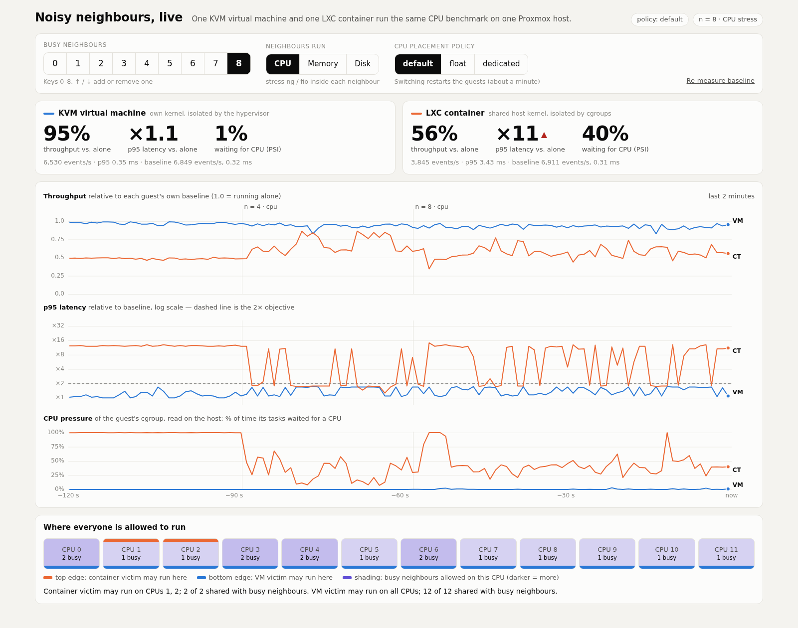
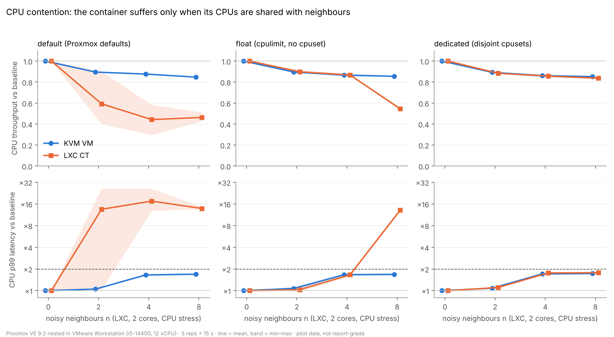
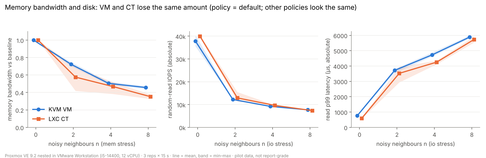
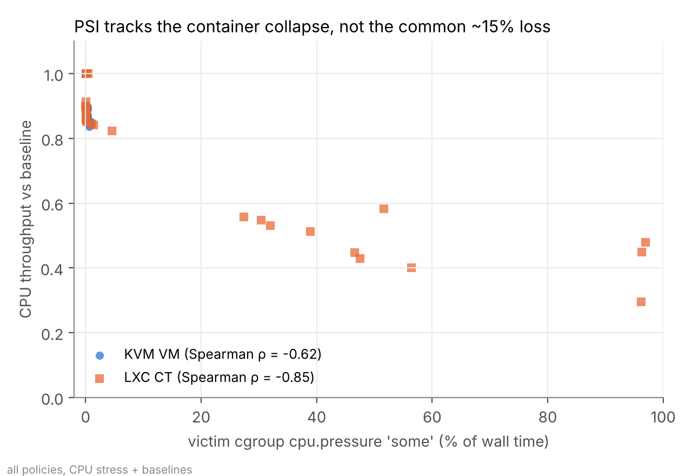

# Noisy Neighbours on Proxmox VE：KVM VM 與 LXC 容器的效能隔離

國立中正大學 作業系統 期末專題，2026 年秋季（兩人一組）。

我們在目前的 Proxmox VE（kernel 7.0、cgroup v2）上重做 Sharma 等人（Middleware 2016）的
*競爭負載干擾*實驗：一個受測 guest（KVM VM 或 LXC 容器）旁邊跑 n 個吵鬧鄰居（LXC 容器），量測它的
CPU、記憶體和磁碟效能掉了多少。每個掉速都用主機端的 kernel 計數器（cgroup v2 PSI）來解釋，而不只是
回報數字。

> **狀態（2026-11-11）：只有 pilot 資料。** 這個 repo 裡的所有結果都來自跑在 *VMware Workstation 裡面*
> 的 Proxmox VE（巢狀虛擬化）。它們對驗證方法和 CPU 擺放效應有用，但 VM 這一邊多了一層虛擬化，磁碟
> 結果也被 VMware 的虛擬磁碟主導。報告等級的數據需要裸機的 Proxmox 主機（規劃中）。

> **計畫（2026-11-12）：同一組實驗矩陣正在第二台機器上重跑**，讓兩組結果可以比較。
> 見[在另一台機器上執行並比較](#在另一台機器上執行並比較)。

## 在另一台機器上執行並比較

量測流程必須和 pilot 完全相同（同一份腳本、同樣的預設值：3 次重複、n = 2、4、8、三種 policy），
否則兩組結果無法比較。這次執行不要更改 `REPS`、`BT`、`NLIST`、`STRESSES`、`POLICIES`。

**需求。** Proxmox VE 9.x、至少 6 顆 CPU（pilot 是 12 顆）、約 12 GB 記憶體、100 GB 可用的 guest
儲存空間、主機可以上網，以及主機所在網段裡 10 個空的 IP（`.60`、`.61`、`.71`–`.78`；ping 得到回應的
位址腳本會拒絕使用）。腳本只會建立和操作 VMID 9100、9101、9111–9118，如果這些 ID 屬於別的東西，
它會拒絕執行。

```bash
# 在 Proxmox 主機上，以 root 身分執行
apt-get update && apt-get install -y git
git clone <這個 repo 的網址> /root/os-noisy-neighbours && cd /root/os-noisy-neighbours

ls /dev/kvm                      # 必須存在，否則 VM 跑不起來（見下方）
bash osproj.sh all               # 建立 guest、跑一次簡短的 preflight，然後在背景跑完整矩陣
bash osproj.sh status            # 查看進度；關掉終端機也會繼續跑，中斷後再執行 'all' 會接續

bash osproj.sh export <標籤>     # 198 組設定都完成後：把結果複製到 results/<標籤>-<日期>/
git add results && git commit -m "Results: <標籤>" && git push
```

完整矩陣要跑好幾個小時（pilot 跑了大半個晚上）。期間請讓機器保持閒置，不要做別的事。

### 第二台機器也是 VMware 裡的 Proxmox（注意事項）

**這次比較能驗證什麼、不能驗證什麼。** 兩台機器都多了一層 VMware，所以第二次量測回答的是
「換一台機器能不能重現」，不是「拿掉巢狀虛擬化之後結論還在不在」。

- 能確認的是**機制**：容器只有在 CPU 和忙碌的鄰居重疊時才掉速、`float` 下的差距來自 cgroup 階層、
  記憶體頻寬和磁碟對兩種 guest 都沒有隔離。
- 不能確認 Proxmox 以下各層的影響，例如「任何 policy 都消不掉的約 15% 損失來自 VMware 排程、SMT 或
  turbo」這個說法。這仍然需要裸機。

**安裝之前，先把 VMware 裡那台 Proxmox VM 設成和 pilot 一樣：**

| VMware 設定 | Pilot | 第二台機器 |
|---|---|---|
| Processors（vCPU 數） | 12 | 12；電腦的硬體執行緒不夠就設少一點，並記下實際數字 |
| Memory | 16 GB | 16 GB |
| 「Virtualize Intel VT-x/EPT or AMD-V/RVI」 | 開 | 開 |
| 主機 Windows 的 hypervisor | 關 | 關：執行 `tools\switch-hypervisor.bat`，選 Proxmox，重開機 |
| Network adapter | NAT | NAT 或橋接都可以，但該網段要有 10 個空 IP |

**三個常見問題**

1. **`/dev/kvm` 不存在。** Windows hypervisor 還在執行（WSL 2、Docker Desktop、Windows Sandbox、
   「記憶體完整性」都會讓它保持開啟），VMware 就無法把 VT-x 傳給 Proxmox。`osproj.sh all` 會立刻停下
   並顯示這個訊息，不會白跑幾個小時。關掉 hypervisor、重開 Windows，再到 Proxmox 裡執行
   `ls /dev/kvm` 確認。
2. **vCPU 數超過電腦的硬體執行緒數。** 這樣 VMware 自己就過載了，它的排程會污染所有數字。到
   工作管理員 › 效能 › CPU 看「邏輯處理器」的數量，vCPU 不要超過它；留兩個執行緒給 Windows 更好。
3. **主機 CPU 有 P-core 和 E-core**（Intel 第 12 代以後）。在 VMware 裡所有 vCPU 看起來都一樣，
   Proxmox 和這個腳本都無法得知某個 vCPU 跑在哪種核心上，guest 裡也沒有任何辦法控制。請把主機的
   CPU 型號寫進比較結果，並列為限制。

**比較時要另外記錄的資訊**（`export` 隔著 VMware 讀不到）：主機的 CPU 型號、核心數與執行緒數、
給 Proxmox VM 的 vCPU 數與記憶體、VMware Workstation 版本、虛擬磁碟放在 SSD 還是傳統硬碟。

### 每台機器不一樣的地方：開始長時間執行前先檢查

| 檢查項目 | 原因 | 怎麼做 |
|---|---|---|
| `/dev/kvm` 存在 | 沒有硬體虛擬化就沒有 VM 這一邊 | 裸機：在 BIOS 開啟 VT-x / AMD-V。Windows 上的 VMware 巢狀環境：替該 VM 開啟「Virtualize Intel VT-x/EPT」，並關閉 Windows hypervisor（`tools/switch-hypervisor.bat`）。WSL 2 和 Docker Desktop 需要它開著，所以只能二選一 |
| 儲存區名稱 | 腳本預設用 `local-lvm`；ZFS 安裝的是 `local-zfs` | `STORE=local-zfs bash osproj.sh all` |
| P-core 與 E-core（Intel 第 12 代以後，裸機） | `dedicated` 會把受測 guest 放在最後兩顆 CPU，在混合架構上那是 E-core | 腳本會印出警告；從 `lscpu -e` 挑兩顆不是 SMT 兄弟的 P-core，例如 `DED=0,2 SHARED=4-15 bash osproj.sh all` |
| CPU 數量 | 不是 12 顆的話，過載（oversubscription）發生的點會移動（pilot 只有 n = 8 過載：18 條執行緒搶 12 顆 CPU） | 不用改設定，但比較時要說明；`NCPU`、`DED`、`SHARED` 都會被記錄 |
| demo 開機自動啟動 | 現場 demo 的服務會讓受測 guest 一直忙碌 | 必須關閉：`bash demo/install-autostart.sh --remove` |

`export` 也會寫出 `platform.txt`（裸機或虛擬化、CPU 型號與拓撲、每顆 CPU 的最高頻率、governor、SMT、
磁碟），讓比較時能明確說出兩台差在哪裡。

**比較**（任何有 Python 3 的機器都可以，不需要額外套件）：

```bash
python3 analysis/compare.py results/nested-2026-10-19 results/<標籤>-<日期> -o results/compare.md
python3 analysis/plot.py results/<標籤>-<日期>     # 替新的結果畫同樣三張圖（需要 pandas、scipy、matplotlib）
```

`compare.py` 會印出兩台的平台資訊、無干擾時的 baseline 絕對值、每個 pilot 結論背後的關鍵數字並列、
baseline 漂移，以及兩台機器相差超過 baseline 0.10 的所有設定。絕對值本來就會不同；重點是每個結論的
*相對*趨勢是否還成立。

## 專題狀態（2026-11-12）

| 項目 | 狀態 | 說明 |
|---|---|---|
| 提案（2 頁摘要，9/29） | ✅ 完成 | 三個問題：baseline、競爭下的隔離、密度 n* |
| 實驗腳本（`osproj.sh`） | ✅ 完成 | 建立 guest、可中斷續跑的矩陣、只操作自己的 VMID |
| 巢狀 Proxmox 上的 pilot 矩陣 | ✅ 完成（10/19） | 198 組設定、無缺值，見 `results/nested-2026-10-19/` |
| Pilot 分析與圖 | ✅ 完成 | `analysis/`，結論見下方 |
| 現場 demo | ✅ 已做好，⚠️ 尚未在主機上排練 | `demo/`，只在模擬模式測試過 |
| 第二台機器的量測 | ⏳ 已準備，尚未執行 | 在另一台主機跑同樣的矩陣，再用 `analysis/compare.py` 比較；報告等級的數據和「VM 與容器的磁碟比較」仍需要裸機 |
| n = 1、p95 指標、5 次重複 | ❌ | 沒有這些，n* 只能給出上界（「< 2」），無法內插 |
| 節流（`cpu.stat`）、`io.stat`、VM steal time | ❌ 未記錄 | 提案要回答每個掉速是由節流、壓力還是 steal 造成 |
| cgroup 階層假說（結論 2） | ❌ 未驗證 | `cat /sys/fs/cgroup/{qemu.slice,lxc}/cpu.weight` 加一次對照實驗 |
| 與 Sharma 等人（2016）的對照表 | ❌ | |
| 期末報告（15 頁，12/29） | ❌ 未開始 | |

和提案不同的地方（要在報告中說明）：guest 用 Debian 而不是 Ubuntu、磁碟 16 GB 而不是 20 GB、兩個受測
guest 一次只跑一個、pilot 用 p99 而不是 p95、n ∈ {0, 2, 4, 8} 且 3 次重複（原訂 n ∈ {0, 1, 2, 4, 8}、
5 次），另外新增了三種 CPU 擺放 policy 和記憶體頻寬的壓力測試。

## Repo 結構

```
osproj.sh                      實驗腳本，這裡所有結果都由它產生（bash，在 Proxmox 主機上執行）
results/nested-2026-10-19/     raw.csv（長格式）、summary.csv、placement.tsv（CPU 擺放紀錄）、meta.txt（平台與 guest 設定）
results/<標籤>-<日期>/         其他機器的結果，由 `osproj.sh export` 寫出（多一份 platform.txt）
analysis/                      load.py + plot.py -> fig1_cpu.png、fig2_mem_io.png、fig3_psi.png
                               compare.py -> 兩組結果的並列比較（只用標準函式庫）
tools/                         switch-hypervisor.bat：開關 Windows hypervisor（WSL 2 與 VMware 裡的巢狀 Proxmox 二選一）
demo/                          現場 demo：可控制鄰居數、壓力種類、policy 的網頁（見 demo/README.md）
tooling/os-isolation/          另一套 Python 實驗框架（隨機區組、1 Hz 取樣器、報告產生器）；
                               只在模擬模式測試過，上面的結果沒有用到它
```

## 實驗設計（results/nested-2026-10-19）

| 因子 | 水準 |
|---|---|
| 受測 guest | KVM VM（Debian 13 cloud image、2 vCPU、2 GB、`cache=none,iothread=1`）· LXC 容器（Debian、2 cores、2 GB、unprivileged） |
| 鄰居 | n = 0、2、4、8 個 LXC 容器（各 2 cores、1 GB） |
| 鄰居的壓力種類 | CPU（`stress-ng --cpu`）、記憶體頻寬（`stress-ng --stream`）、磁碟（`fio` 4k randrw QD32 direct） |
| CPU 擺放 policy | `default`（Proxmox 預設）· `float`（`cpulimit`、不設 cpuset）· `dedicated`（受測 guest 和鄰居的 cpuset 不重疊） |
| 受測 guest 的 benchmark（各 15 秒） | `sysbench cpu`（events/s、p99）、`sysbench memory`（MiB/s）、`fio` 4k randread QD16 direct（IOPS、p99）、1 ms sleep 的喚醒延遲 |
| 重複 | 3 次；每次重複輪換 policy 順序、壓力設定隨機排序、每個區塊開始前量 baseline、結束後檢查漂移 |

主機：Proxmox VE 9.2.2，12 vCPU / 16 GB，巢狀跑在 Intel i5-14400（Windows 11）上的 VMware Workstation 17。

執行方式（在 Proxmox 主機上，以 root 身分）：`bash osproj.sh all` · `bash osproj.sh status` ·
`bash osproj.sh summary` · `bash osproj.sh export [標籤]` · `bash osproj.sh policy <default|float|dedicated>` ·
`bash osproj.sh clean`（只會刪除專題自己的 guest，VMID 9100、9101、9111–9118，而且會先檢查名稱）。

重畫圖：`pip install pandas numpy scipy matplotlib && python3 analysis/plot.py`

## 現場 demo

demo 現場展示 pilot 的主要結論：在 Proxmox 預設設定下，忙碌的鄰居一落到容器的 CPU 上，容器就明顯
變慢，VM 幾乎不受影響；明確指定 CPU 之後，這個差距就消失。完整說明見 [demo/README.md](demo/README.md)。



10 張實測截圖（default／dedicated／float，n = 0–8）和對應數字見 [demo/README.md](demo/README.md#screenshots-from-the-host)。

**簡報時的配置。** 跑 VMware + Proxmox 的桌機透過 Chrome 遠端桌面操作。demo 網頁是在*那台桌機上*的
瀏覽器開啟（VMware 的 NAT 網路只有那台機器連得到），所以觀眾看到的是遠端桌面的畫面。Proxmox 主機上
只需設定一次：`bash <repo>/demo/install-autostart.sh`。

**簡報前（提早 10 分鐘開始）**

| 時間 | 步驟 | 應該看到 |
|---|---|---|
| T−10 分 | 在桌機上雙擊 `demo\start-demo.bat` | 一個主控台視窗：VM 開機，接著顯示 Proxmox 的 IP |
| T−7 分 | 瀏覽器自動開啟 `http://<proxmox-ip>:8080/` | 黃色橫幅「Starting guests and benchmarks…」 |
| T−5 分 | 橫幅消失 | 兩個數字卡都在約 100%，policy 標籤顯示目前的 policy |
| T−5 分 | 如果 policy 不是 `default`，點 **default** 並等待（約 1–2 分鐘） | guest 重新啟動，數字卡回到約 100% |
| T−2 分 | 看 CPU 配置圖：容器拿到哪兩顆 CPU？ | 兩顆 CPU 上緣有橘色標記 |
| T−1 分 | 關掉 `start-demo.bat` 的主控台視窗，只留瀏覽器並全螢幕（F11） | |

**台上（約 4 分鐘）**

| 步驟 | 動作 | 觀眾看到 | 要說的話 |
|---|---|---|---|
| 1 | 不動作（n = 0） | 兩個 guest 都是 100%，PSI 0% | VM 和容器跑同一個 CPU benchmark；數字是相對於各自單獨跑時的表現 |
| 2 | 指向 CPU 配置圖 | 容器被限制在 2 顆 CPU（橘色），VM 可以用全部 12 顆（藍色） | Proxmox 預設給每個容器固定 2 顆 CPU 的 cpuset |
| 3 | 一次按一下 `↑`，按到 4，每次之後等約 10 秒 | 紫色陰影逐漸蓋到各顆 CPU；鄰居落到橘色 CPU 後 2–4 秒內，容器掉下來、p95 越過 2× 的虛線、CPU 壓力跳升 | 容器不是變慢，而是在*等待*：PSI 從主機端量到的就是這個 |
| 4 | 按 `8` | 容器大約 40–60%，p95 超過 10×；VM 維持在 85–90% | pilot 資料裡，n = 8 時每次重複都發生 |
| 5（選配，多 2 分鐘） | 按 `0`，點 **dedicated**，在約 1–2 分鐘的重啟期間繼續講，然後按 `8` | 兩條曲線一起落在約 85% | 差距來自 CPU 擺放，而不是虛擬化技術；剩下約 15% 是共用硬體造成，任何 policy 都消不掉 |
| 結束 | 按 `0` | 兩者都回到約 100% | |

注意：每次按鍵後要 2–4 秒曲線才會動（鄰居啟動 + 1 秒取樣 + 1 秒網頁更新），所以每一步之後要停頓。
在 `default` 下，Proxmox 給容器的 CPU 每次啟動都不一樣，所以第 3 步容器在哪個 n 掉下來並不固定；
第 4 步（n = 8）才是穩定的。按鍵：`0`–`8`、`↑`/`↓`；瀏覽器分頁必須有焦點（在遠端桌面切換視窗後，
先在網頁上點一下）。結束時執行 `demo\stop-demo.bat`，簡報後把開機自動啟動關掉：
`bash <repo>/demo/install-autostart.sh --remove`。

## Pilot 結論（巢狀平台，3 次重複）



1. **CPU：容器只有在它的 CPU 和忙碌的鄰居重疊時才會變慢。** 在 Proxmox 預設設定下，容器的 cpuset
   在大多數量測中都和活動中的鄰居重疊：CPU 吞吐量掉到 baseline 的 0.44–0.59，p99 延遲上升 13–17 倍，
   而 VM 維持在 0.85–0.90。cpuset 不重疊（`dedicated`）時，兩條曲線重合。
2. **未解問題：VM 的優勢來自 cgroup 階層嗎？** 不綁核（`float`）時，容器在 n = 8 仍然崩落（0.55、
   p99 13 倍），VM 則沒有（0.86）。假說：VM 獨自在 `qemu.slice` 底下，而受測容器和八個鄰居共用
   `lxc/`。尚未驗證。
3. **有約 15% 的損失是任何擺放 policy 都消不掉的**（CPU 不重疊時也一樣），而且 PSI 看不到：可能是
   頻率調整、SMT 共用，或巢狀 vCPU 在主機上的排程。
4. **記憶體頻寬和磁碟對兩種 guest 都沒有隔離。** 在磁碟壓力下，兩者收斂到相同的絕對效能（n = 8 時
   約 7.2k IOPS、p99 約 5.9 ms）；容器的*相對*跌幅較大是因為它的 baseline 較高，不是隔離較差。
5. **歸因：** 受測 cgroup 的 CPU PSI 能追蹤容器的 CPU 掉速（Spearman ρ = −0.85）；I/O PSI 在兩種
   guest 之間不可比較（容器的非同步 libaio 等待不會被計入）。




## 剩下的工作（依順序）

1. 擴充 `osproj.sh`：加入 n = 1、在 p99 之外同時記錄 p95、每次量測讀取 `cpu.stat`（節流）、`io.stat`
   和 VM 的 steal time。
2. 驗證 cgroup 階層假說（結論 2）。
3. 在第二台機器上重跑未修改的矩陣並比較（`analysis/compare.py`）；之後在裸機的 Proxmox 主機上以更多
   重複次數重跑（至少 `default` policy）。
4. 分析：掉速曲線、帶區間的 n*、歸因、VM 與容器的檢定、和 Sharma 等人（2016）的比較。
5. 期末報告（15 頁），寫明每位成員的分工。

## 參考文獻

1. W. Felter, A. Ferreira, R. Rajamony, J. Rubio. *An Updated Performance Comparison of Virtual Machines and Linux Containers.* IEEE ISPASS 2015.
2. P. Sharma, L. Chaufournier, P. Shenoy, Y. C. Tay. *Containers and Virtual Machines at Scale: A Comparative Study.* Middleware 2016.
3. Linux kernel documentation, *Control Group v2* and *PSI — Pressure Stall Information*.
4. Proxmox VE Administration Guide.
