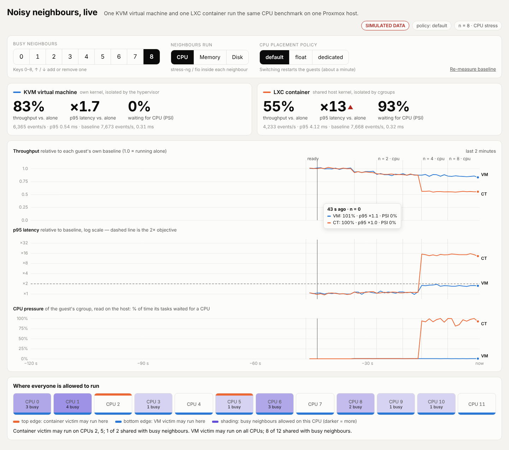

# Live demo

A web page that shows, second by second, how a KVM virtual machine and an LXC container react while
noisy neighbours are switched on one at a time.



*Screenshot taken in simulation mode; the numbers are fake.*

## One-click start (Windows + VMware)

One-time setup, in the Proxmox shell (web console › Shell), as root:

```bash
cd /root && git clone https://github.com/Nota0w0/os-noisy-neighbours.git   # skip if already cloned
bash /root/os-noisy-neighbours/demo/install-autostart.sh
```

This installs `open-vm-tools` and a systemd service (`os-demo`) that pulls the latest code and starts
`demo/demo.py` at every boot. After that, on Windows just double-click **`demo\start-demo.bat`**: it powers on
the VMware VM in the background (`vmrun … nogui`), asks VMware for the Proxmox IP, waits until the demo page
answers and opens it in the browser. No console login and no typing in the Proxmox shell.
`demo\stop-demo.bat` shuts Proxmox down cleanly.

The VM path is set at the top of `start-demo.ps1`
(default `Documents\Virtual Machines\Ubuntun\Ubuntun.vmx`). If VMware cannot report the IP, put it on
one line in `demo\pve-ip.txt`.

**After the talk** turn auto-start off, otherwise every boot starts all guests and keeps the victims busy
(`osproj.sh all` refuses to run while the service is active):
`bash /root/os-noisy-neighbours/demo/install-autostart.sh --remove`

## Run by hand

On the Proxmox host, as root, after `bash osproj.sh all` has built the guests:

```bash
python3 demo/demo.py            # prints http://<proxmox-ip>:8080/ — open it in a browser on the laptop
```

Without Proxmox (to rehearse the page and the talk): `DEMO_SIM=1 python3 demo/demo.py`, then http://localhost:8080/.

Standard library only. `Ctrl+C` stops the neighbour load and the benchmarks; the guests stay running.

## What is on the page

| Part | Meaning |
|---|---|
| **Busy neighbours** 0–8 | how many neighbour containers run a stress workload (keys `0`–`8`, `↑`/`↓`) |
| **Neighbours run** | CPU (`stress-ng --cpu`), memory bandwidth (`stress-ng --stream`) or disk (`fio` randrw) |
| **CPU placement policy** | `default` = Proxmox defaults · `float` = no pinning, CPU quota only · `dedicated` = victims and neighbours on disjoint CPUs. Switching calls `osproj.sh policy <name>` and restarts the guests (about a minute) |
| Tiles | each victim's throughput and p95 latency relative to its own baseline, plus cgroup CPU pressure |
| Charts | the same three quantities over the last two minutes; vertical lines mark every change |
| CPU map | which CPUs each victim may use and how many busy neighbours share each CPU |

Both victims run `sysbench cpu --threads=2 --report-interval=1 --percentile=95` continuously. The baseline
is the median of the samples taken while no neighbour is busy; it is re-measured after a policy switch
or with **Re-measure baseline**.

## Demo flow

The step-by-step flow for the talk (timings, what to press, what the audience sees) is in the
[main README](../README.md#live-demo).

## Limits

- Only the project's guests are touched (VMIDs 9100, 9101, 9111–9118; names are checked at start).
- The page has no login. It accepts only the fixed choices above, but run it on a network you trust.
- Under `default`, which CPUs the container gets is decided by Proxmox at start, so step 2 may need more
  or fewer neighbours from one run to the next. Check the CPU map before the talk.
- Tested end to end in simulation mode only; the Proxmox code path reuses the commands of `osproj.sh`
  but has not been run on a host yet. Rehearse once on the real host.
