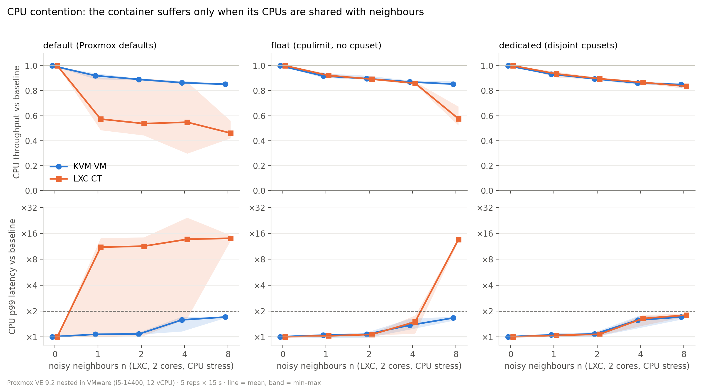
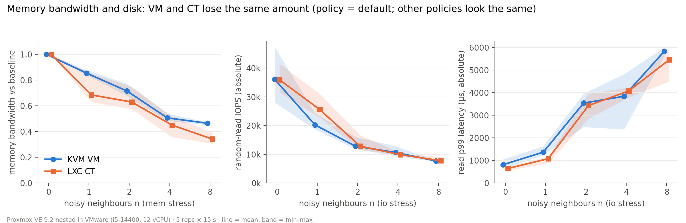
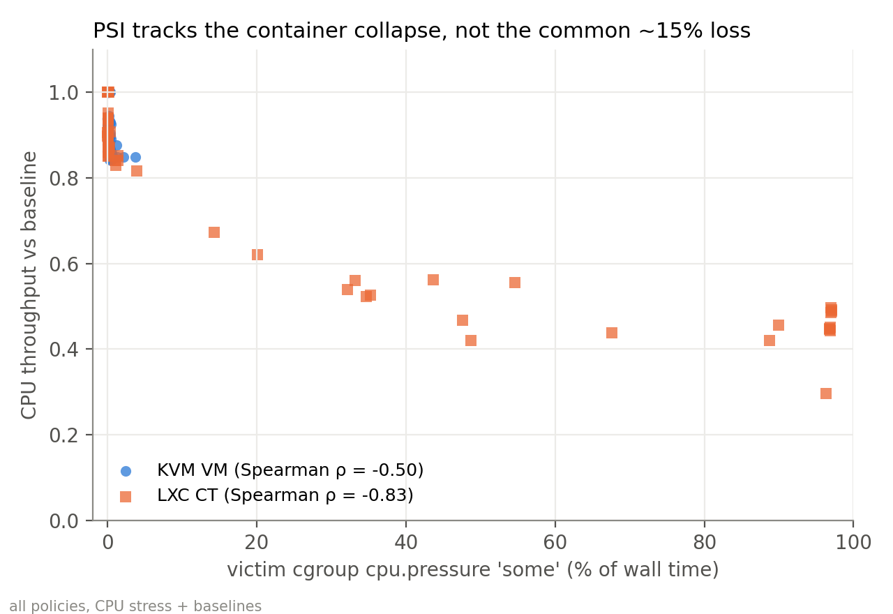

# Nested v2 run (2026-11-12/13) — preliminary report

> **Platform caveat.** Proxmox VE runs nested inside VMware Workstation on a desktop i5-14400.
> Every number below is **nested, not report-grade**: it shows what this harness measures on this
> machine, not how KVM and LXC behave on bare metal. Read the conclusions as hypotheses to re-test.

All numbers in this file come from `raw.csv` in this directory, via
`python3 analysis/report_stats.py results/nested-v2-2026-11-13 results/nested-2026-10-19`
(output: `report_stats.md`), `analysis/compare.py` (output: `compare.md`) and `summary.txt`.
"Relative" always means *relative to the uncontended baseline measured in the same block (same policy, same rep, same victim)*.

## 1. Setup

| item | value |
|---|---|
| host | Proxmox VE 9.2.2, kernel 7.0.2-6-pve, nested in VMware Workstation 17.6.4 on Windows 11 |
| CPU / RAM / disk | i5-14400 (6P+4E, 16 threads) exposed as 12 vCPU (no SMT, no cpufreq) · 16 GB · 150 GB VMware virtual disk, `local-lvm` thin pool |
| victims | `victim-vm` (KVM, 2 vCPU, 2 GB, Debian 13 cloud kernel 6.12, virtio-scsi-single, iothread, cache=none) and `victim-ct` (unprivileged LXC, 2 cores, 2 GB, Debian 13, host kernel) |
| neighbours | `nbr1–8`: LXC, 2 cores, 1 GB each; stress = `stress-ng --cpu 2` / `stress-ng --stream 2` / `fio randrw 4k QD32` |
| victim benchmarks | `sysbench cpu` (events/s, p99 latency), `sysbench memory` (MiB/s), `fio randread 4k QD16 libaio direct` (IOPS, p99), wake-up latency probe; 15 s each |
| policies | `default` (Proxmox defaults, CT gets a 2-CPU cpuset chosen at start), `float` (cpulimit = cores, no cpuset), `dedicated` (victims pinned to CPUs 10–11, neighbours to 0–9) |
| matrix | 3 policies × 2 victims × 5 reps × (baseline + 3 stresses × n ∈ {1,2,4,8} + post-block drift check) = **420 configurations**, 559 min, 0 NA values |
| vCPU overcommit ρ(n) = (2+2n)/12 | 0.33, 0.50, 0.83, **1.50** for n = 1, 2, 4, 8 — only n = 8 is overcommitted |
| code | `knowsiam/s-noisy-neighbours-v2@d3827d9` (+ `analysis/plot.py` n-axis fix, + `analysis/report_stats.py`) |

**Differences from the pilot (2026-10-19):** 5 instead of 3 repetitions; n = 1 added (n ∈ {1,2,4,8} instead of {2,4,8});
v2 harness (host checks, export). Same platform, same guests, same benchmarks, same 15 s duration.

**Differences from the proposal (9/29):**
- Density is defined on **p99** latency, not p95 — the harness records p99 only.
- `cpu.stat` throttling, `io.stat` and VM steal time are **not recorded**. Only PSI (victim cgroup cpu/io, host cpu) is available for attribution.
- Guests are Debian 13, host has 16 GB; victims run **one at a time** (VM block, then CT block), never concurrently.

## 2. Reproducibility of the uncontended baseline (n = 0, 5 reps)

mean / coefficient of variation; ⚠ = CV > 5 % (throughput) or > 10 % (p99).

| policy | victim | CPU events/s | memory MiB/s | disk IOPS | CPU p99 ms | disk p99 µs |
|---|---|---|---|---|---|---|
| default | vm | 7715 / 0.5 % | 58 686 / 2.0 % | 36 088 / **20.2 % ⚠** | 0.320 / 0.0 % | 807 / **20.1 % ⚠** |
| default | ct | 7762 / 0.9 % | 58 231 / 1.8 % | 35 949 / **13.4 % ⚠** | 0.314 / 3.6 % | 641 / **12.3 % ⚠** |
| float | vm | 7663 / 1.4 % | 58 904 / 0.8 % | 36 567 / 1.7 % | 0.326 / 4.1 % | 764 / 4.4 % |
| float | ct | 7761 / 0.3 % | 59 441 / 0.7 % | 42 247 / 1.7 % | 0.314 / 1.7 % | 549 / 3.9 % |
| dedicated | vm | 7688 / 0.6 % | 59 275 / 2.1 % | 28 068 / 0.7 % | 0.324 / 4.7 % | 972 / 1.2 % |
| dedicated | ct | 7736 / 0.7 % | 59 625 / 1.7 % | 41 987 / 2.6 % | 0.312 / 2.7 % | 561 / 2.1 % |

- CPU and memory baselines are stable (CV ≤ 2.1 %) and match the pilot within 2 % (`compare.md`).
- **Disk baselines under `default` are not reproducible** (CV 13–20 %; per-rep IOPS range 28.0k–47.3k for the VM, 31.5k–41.4k for the CT).
  The post-block drift check agrees: under `default` the end-of-block IOPS is 1.20× (VM, range 0.81–1.42) and 1.13× (CT, 0.97–1.30) the start-of-block value,
  while every other policy/victim stays within 0.97–1.00 on average. Disk results under `default` should therefore be read with wide error bars.
  We do not know the cause (candidates: thin-pool / VMware virtual-disk caching on the Windows host). CPU drift is 0.99–1.00 everywhere.

## 3. Results

> Note on figure titles: the titles are inherited from the pilot scripts. The fig2 title ("VM and CT lose the same amount") holds for disk but
> **not for memory bandwidth under `default`/`float`** (see 3.2).

### 3.1 CPU stress (relative CPU throughput, mean of 5 reps)

| policy | victim | n=1 | n=2 | n=4 | n=8 | p99 × at n=8 |
|---|---|---|---|---|---|---|
| default | vm | 0.92 | 0.89 | 0.86 | 0.85 | 1.70 |
| default | ct | 0.57 | 0.54 | 0.55 | 0.46 | 14.07 |
| float | vm | 0.92 | 0.90 | 0.87 | 0.85 | 1.66 |
| float | ct | 0.92 | 0.89 | 0.86 | 0.58 | 13.60 |
| dedicated | vm | 0.93 | 0.90 | 0.86 | 0.85 | 1.70 |
| dedicated | ct | 0.94 | 0.90 | 0.87 | 0.84 | 1.79 |

**Under `default`, the container's loss is set by cpuset overlap, not by n** (CPU + memory stress, n ≥ 1, `report_stats.md` §5):

| CT CPUs shared with busy neighbours | configs | rel. CPU throughput mean (min–max) | rel. p99 |
|---|---|---|---|
| 0 | 6 | 0.89 (0.87–0.91) | 1.2× |
| 1 | 20 | 0.48 (0.44–0.55) | 13.8× |
| 2 | 14 | 0.44 (0.30–0.56) | 15.3× |

A single overlapping neighbour (n = 1) is already enough to halve the container's throughput; in rep 1 the CT's cpuset (CPUs 2,5)
did not overlap any busy neighbour until n = 8, and at n = 1–4 it stayed at 0.87–0.91. The VM, whose vCPU threads may run on any of the 12 CPUs,
loses 0.08–0.15 regardless of overlap.

### 3.2 Memory-bandwidth stress (relative memory bandwidth)

| policy | vm n=8 | ct n=8 |
|---|---|---|
| default | 0.46 (0.45–0.47) | 0.34 (0.31–0.39) |
| float | 0.46 (0.45–0.47) | 0.38 (0.33–0.40) |
| dedicated | 0.47 (0.46–0.48) | 0.45 (0.43–0.47) |

Memory bandwidth is not isolated for either guest type (≈ 0.5 at n = 4 for both under `dedicated`). The extra CT loss under `default`/`float`
coincides with its CPU loss in the same configurations (rel. CPU 0.45/0.54 at n = 8), i.e. the bandwidth test is also CPU-starved there.

### 3.3 Disk stress

- Both guest types collapse to the same absolute level at n = 8: 7.2k–7.8k IOPS and 5.4–6.0 ms p99 for every policy/victim (`report_stats.md` §6).
- Relative IOPS at n = 8: 0.17–0.26. Disk p99 crosses 2× already at n ≈ 1 for every policy and victim (§4).
- **Cross-resource effect on the VM:** under CPU stress (no disk stress at all) the VM's disk IOPS falls to 0.13 (`default`) and 0.17 (`float`) at n = 8,
  but only to 0.65 under `dedicated`; the container keeps 0.70–0.75. This reproduces the pilot (0.11 / 0.20 / 0.65) and is consistent with
  the QEMU I/O thread competing with busy neighbours for CPU time when it is not pinned.

## 4. Density n* (first n where mean relative p99 ≥ 2)

Linear interpolation over n = 0, 1, 2, 4, 8 on the 5-rep mean; interval = n* of the per-n max curve (earliest) to n* of the per-n min curve (latest).
"≤ 1" means the threshold is already crossed at the smallest measured n (interpolating between n = 0 and 1 has no physical meaning).
The table lists the latency metric that matches each stress (CPU p99 for CPU stress; disk p99 for disk stress) plus the cross-resource case that matters
for the VM; the full 36-row table is in `report_stats.md` §2.

| policy | stress → p99 metric | VM n* (interval) | CT n* (interval) |
|---|---|---|---|
| default | cpu → CPU p99 | n = 8 still < 2 (1.70) | **≤ 1** (0.08 – 4.13) |
| float | cpu → CPU p99 | n = 8 still < 2 (1.66) | **4.17** (4.07 – 4.30) |
| dedicated | cpu → CPU p99 | n = 8 still < 2 (1.70) | n = 8 still < 2 (1.79) |
| default | mem → CPU p99 | n = 8 still < 2 (1.72) | ≤ 1 (0.08 – 4.12) |
| float | mem → CPU p99 | n = 8 still < 2 (1.67) | 4.13 (4.08 – 4.27) |
| dedicated | mem → CPU p99 | 2.57 (2.12 – >8) ¹ | n = 8 still < 2 (1.78) |
| default | io → disk p99 | 1.09 (0.82 – 1.37) | 1.08 (0.92 – 1.21) |
| float | io → disk p99 | 1.09 (0.74 – 1.28) | 1.01 (0.97 – 1.05) |
| dedicated | io → disk p99 | 1.28 (1.21 – 1.45) | 1.03 (1.00 – 1.10) |
| default | cpu → disk p99 | **4.22** (4.13 – 4.39) | 2.87 (2.30 – >8) |
| float | cpu → disk p99 | **3.90** (3.35 – 4.14) | n = 8 still < 2 (1.71) |
| dedicated | cpu → disk p99 | 6.95 (4.89 – 7.56) | n = 8 still < 2 (1.62) |

¹ Driven by one outlier: rep 1 at n = 4 measured 4.41 ms (other reps 0.54–0.55 ms); the median relative p99 at n = 4 is 1.69 and the n = 8 mean is 1.69,
so without that rep the VM does not reach 2× under `dedicated`/mem.

Reading: for CPU, the container under `default` has essentially no density headroom (n* ≤ 1 whenever its cpuset overlaps a neighbour, and the
interval shows it depends entirely on placement); under `float` it holds until the host is overcommitted (between n = 4 and 8). The VM never reaches
2× CPU p99, but its *disk* p99 does at n ≈ 4 under CPU stress. For disk stress, neither guest type tolerates even one noisy neighbour.

## 5. Comparison with the pilot

v2 means fall inside the pilot's 3-rep min–max for 50–81 % of the (policy, victim, stress, n ∈ {2,4,8}) cells depending on the metric
(CPU throughput 67 %, memory 81 %, IOPS 61 %, CPU p99 63 %, disk p99 50 %). 31 cells miss the pilot band by more than 0.05 (19 below, 12 above); 26 of them are
latency ratios, mostly at n = 2–4, where a 3-rep band is narrow (`report_stats.md` §3). Systematic differences > 0.10 in throughput are listed in `compare.md` and are all in `default`
(where cpuset placement differs per rep) or in disk IOPS (where the `default` baseline is noisy).

| # | pilot finding | v2 | verdict |
|---|---|---|---|
| 1 | Under `default`, CT drops to 0.44–0.59 with 13–17× p99 when its cpuset overlaps busy neighbours; VM stays 0.85–0.90; `dedicated` curves coincide | CT 0.46–0.57 (n = 1–8), p99 11–14×; VM 0.85–0.92; `dedicated` VM 0.85 / CT 0.84 at n = 8. New: overlap of a single CPU (n = 1) suffices; no overlap → 0.89 | **Reproduced** (and refined) |
| 2 | Under `float`, CT collapses at n = 8 (0.55) while VM holds (0.86); hypothesis: cgroup hierarchy | CT 0.58 (0.52–0.67) vs VM 0.85 at n = 8; CT tracks the VM up to n = 4 (0.86 vs 0.87). cgroup weights read: all 100 (see §6) | Observation **reproduced**; hypothesis **plausible, not tested** |
| 3 | ~15 % loss that no policy prevents and PSI does not see | `dedicated`, CPU stress, n = 8: VM 0.849 / CT 0.835 with victim CPU PSI 0.41 % / 1.75 %; the loss grows with n even with disjoint cpusets (n = 1 → 8: VM 0.93 → 0.85, CT 0.94 → 0.84) while host CPU PSI is 49.8 % | **Reproduced** (cause still unknown) |
| 4 | Memory bandwidth and disk not isolated for either; disk converges to ~7.2k IOPS at n = 8; CT's larger relative drop is due to its higher baseline | Memory n = 8 `dedicated` 0.47 / 0.45. Disk n = 8: 7.2k–7.8k IOPS for all. Under `float`/`dedicated` CT baseline is higher (42k vs 28–37k) and its relative drop larger (0.17–0.18 vs 0.21–0.26); under `default` baselines are equal (36.1k / 35.9k) and so are the relative drops (0.22 / 0.22) | **Reproduced** |
| 5 | CT CPU PSI correlates with degradation (ρ = −0.85); IO PSI not comparable across victim types | CT ρ = −0.83 (N = 75, p < 1e-19), VM ρ = −0.50. IO PSI at n = 8 disk stress: VM 12.6 / 11.5 / 42.4 %, CT 23.1 / 5.5 / 9.4 % (default / float / dedicated) while absolute IOPS are nearly equal | **Reproduced** |
| 6 | `qm set --affinity` also pins the iothread; VM disk baseline 37.8k → 28.3k IOPS under `dedicated` | VM disk baseline `dedicated` 28.1k vs `default` 36.1k / `float` 36.6k; disk p99 972 vs 807 / 764 µs | **Reproduced** |

The pilot's VM-disk-under-CPU-stress result (compare.md "Finding 3": 0.11 / 0.20 / 0.65) is also reproduced (0.13 / 0.17 / 0.65).

## 6. Attribution

**PSI.** Victim-cgroup CPU PSI tracks the container's throughput loss (Spearman ρ = −0.83 over all policies; −0.64 to −0.67 within each policy)
— containers losing half their throughput show 33–97 % `some` pressure. For the VM, CPU PSI stays ≤ 3.7 % and ρ = −0.50: PSI of the
`qemu.slice/9100.scope` cgroup sees host-side runnable delay of the vCPU threads but not the ~15 % common loss. The common loss (finding 3)
is invisible to victim PSI in both guest types; candidates (not measured here): shared memory bandwidth/LLC, VMware vCPU scheduling on the
Windows host (16 threads for 12 Proxmox vCPUs plus host load), and the absence of steal-time accounting.

**cgroup weights (read-only, no setting changed).** Read on 2026-11-13 from `/sys/fs/cgroup`:

| cgroup | cpu.weight |
|---|---|
| `qemu.slice` | 100 |
| `lxc` | 100 |
| `lxc/9101` (victim-ct) | 100 |
| `lxc/9111` … `lxc/9118` | 100 each |
| `qemu.slice/9100.scope` (victim-vm) | 100 |

The `lxc/*` and `qemu.slice` values were read during a `float` block (rep 4, CT victim). `9100.scope` exists only while the VM runs and was read
during a `default` block (rep 5); `osproj.sh` never sets `cpu.weight` or `cpuunits`, so the value does not depend on the policy.

The two top-level branches have equal weight, so the **precondition of the pilot's hypothesis holds**: under CPU contention the kernel first splits
CPU time between `qemu.slice` and `lxc`, then among the 9 containers inside `lxc`. A back-of-envelope check is consistent with the data:
at `float`, n = 8, the CT victim and 8 neighbours each ask for 2 CPUs (18 in total) inside `lxc`, so an equal-weight share is 12 / 9 ≈ 1.33 CPUs,
i.e. ≤ 0.67 of the victim's 2 vCPUs; multiplied by the common ~0.85 this predicts ≈ 0.57, measured 0.58. The VM (alone in `qemu.slice`, which
may claim up to half the host = 6 CPUs) needs only 2 and loses only the common part (0.85). At n ≤ 4 total demand is ≤ 10 CPUs < 12, so
no fair-share cut happens, matching the CT's 0.86 at n = 4.
This is a consistency check, **not a test**: confirming it needs a counterfactual (e.g. moving the CT victim to its own top-level cgroup, or
running the VM inside `lxc`-equivalent weight), which this run did not do.

## 7. Limitations

- **Nested virtualisation.** Proxmox runs on VMware Workstation; vCPU scheduling, the virtual disk and the absence of cpufreq/SMT information are
  VMware's. Absolute numbers and the ~15 % common loss may be artefacts of nesting.
- Single machine, single run per configuration per rep; 15 s per benchmark.
- p99 instead of the proposal's p95.
- No `cpu.stat` throttling (float uses `cpulimit`, so throttling is expected there but unmeasured), no `io.stat`, no VM steal time.
- `default` disk baselines have CV 13–20 % and drift up to 1.42× within a block (§2).
- The two victims are measured in separate blocks, never against each other.
- Cpuset placement under `default` is chosen by Proxmox at container start and differs per rep (`placement.tsv`); `default` CT results are a
  mixture of overlap 0/1/2 (§3.1).

## 8. Next steps

1. Re-run on bare metal (Hyper-V/VMware off the path) with the same `NLIST="1 2 4 8" REPS=5`; use `compare.py` against this run.
2. Extend the harness: record p95 alongside p99, `cpu.stat` (nr_throttled / throttled_usec), `io.stat`, and steal time inside the VM (`/proc/stat`).
3. Test the cgroup-weight hypothesis with a counterfactual (see §6) instead of inferring it.
4. Control `default` placement explicitly (overlap 0/1/2 as a factor) rather than leaving it to chance.
5. Build the comparison table against Sharma et al. (Middleware 2016) competing-workload interference results (CPU, memory, disk; VM vs container).
