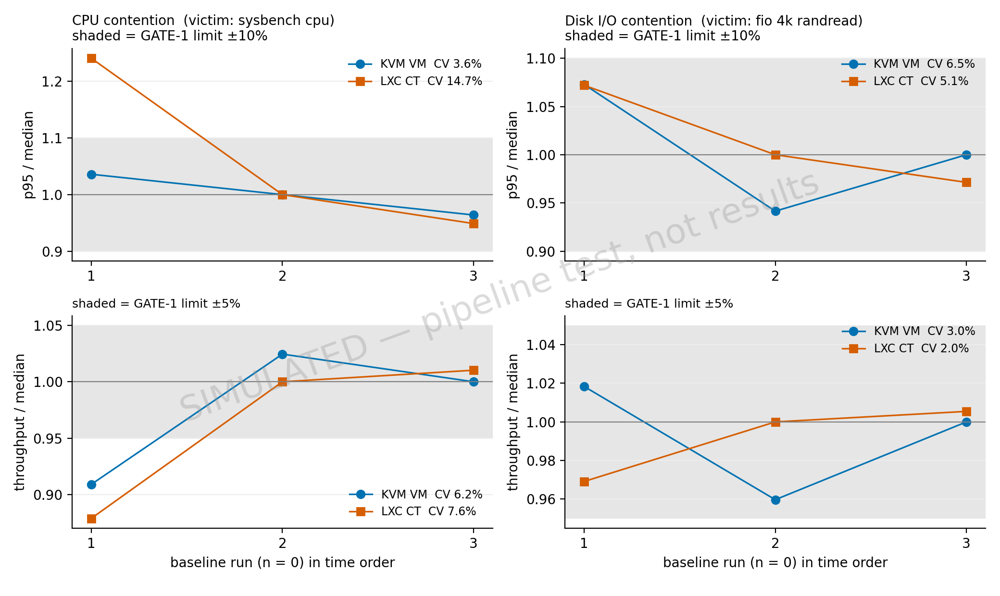
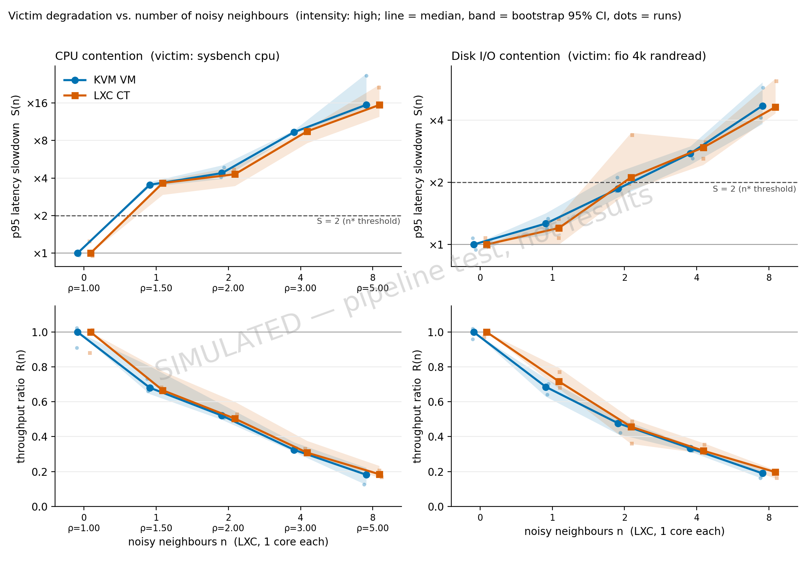
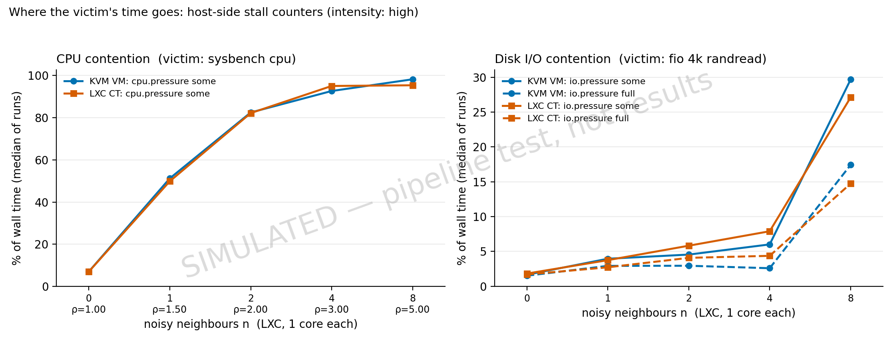
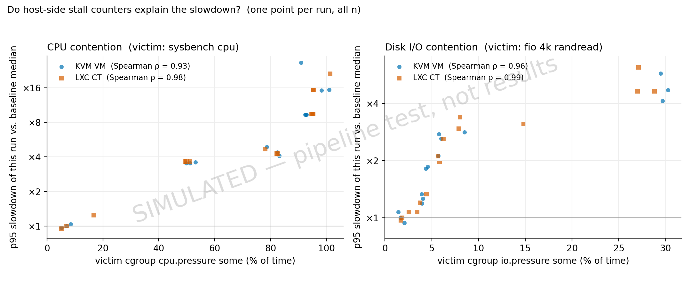

# Results summary — simtest

> **SIMULATED DATA** — produced by `EXP_SIMULATE=1` to test the pipeline. Do not report any number from this file.

- generated: 2026-10-12T13:26:14+08:00
- platform: `SIMULATED`; CPU ?, 2 logical CPUs; neighbour cores 1
- config version(s): sim-test
- runs: 60 ok, 0 failed (failed runs are excluded and listed at the end)

## 1. Baseline and reproducibility gate (RQ1, GATE-1)

GATE-1 passes when, at n = 0, CV(throughput) < 5% and CV(p95) < 10% with at least 3 runs.

| arm | dim | runs | unit | throughput_median | throughput_cv_pct | p95_ms_median | p95_cv_pct | gate1 |
|---|---|---|---|---|---|---|---|---|
| ct | cpu | 3 | events/s | 1,988 | 7.59 | 1.37 | 14.7 | FAIL |
| ct | io | 3 | IOPS | 55,769 | 1.97 | 0.57 | 5.11 | PASS |
| vm | cpu | 3 | events/s | 1,956 | 6.22 | 1.39 | 3.60 | FAIL |
| vm | io | 3 | IOPS | 58,791 | 3.02 | 0.56 | 6.55 | PASS |

- cpu: uncontended VM/CT throughput = 0.984, p95 = 1.015 (virtualisation overhead with no neighbours)
- io: uncontended VM/CT throughput = 1.054, p95 = 0.986 (virtualisation overhead with no neighbours)

## 2. Slowdown curves (ANA-02)

S = median p95(n) / median p95(0); R = median throughput(n) / median throughput(0). [lo, hi] = bootstrap 95% CI; IQR = interquartile range of the per-run ratios. ρ = (victim cores + n × neighbour cores) / logical CPUs.

| dim | arm | intensity | n | rho | runs | p95_ms | S [95% CI] | S IQR | R [95% CI] |
|---|---|---|---|---|---|---|---|---|---|
| cpu | ct | high | 0 | 1.00 | 3 | 1.37 | 1.00 [1.00, 1.00] | 0.97–1.12 | 1.00 [1.00, 1.00] |
| cpu | ct | high | 1 | 1.50 | 3 | 5.00 | 3.65 [2.94, 3.85] | 3.65–3.65 | 0.67 [0.66, 0.78] |
| cpu | ct | high | 2 | 2.00 | 3 | 5.88 | 4.29 [3.46, 4.95] | 4.29–4.49 | 0.50 [0.49, 0.60] |
| cpu | ct | high | 4 | 3.00 | 3 | 13.0 | 9.47 [7.64, 9.98] | 9.47–9.47 | 0.31 [0.30, 0.38] |
| cpu | ct | high | 8 | 5.00 | 3 | 21.1 | 15.4 [12.4, 22.5] | 15.4–18.4 | 0.18 [0.16, 0.23] |
| cpu | vm | high | 0 | 1.00 | 3 | 1.39 | 1.00 [1.00, 1.00] | 0.98–1.02 | 1.00 [1.00, 1.00] |
| cpu | vm | high | 1 | 1.50 | 3 | 4.91 | 3.53 [3.41, 3.73] | 3.53–3.56 | 0.68 [0.64, 0.80] |
| cpu | vm | high | 2 | 2.00 | 3 | 6.09 | 4.38 [3.94, 5.07] | 4.23–4.63 | 0.52 [0.50, 0.59] |
| cpu | vm | high | 4 | 3.00 | 3 | 13.0 | 9.34 [9.01, 9.69] | 9.34–9.34 | 0.32 [0.31, 0.37] |
| cpu | vm | high | 8 | 5.00 | 3 | 21.5 | 15.5 [14.7, 27.5] | 15.3–21.0 | 0.18 [0.12, 0.22] |
| io | ct | high | 0 | – | 3 | 0.57 | 1.00 [1.00, 1.00] | 0.99–1.04 | 1.00 [1.00, 1.00] |
| io | ct | high | 1 | – | 3 | 0.68 | 1.20 [1.00, 1.37] | 1.14–1.27 | 0.72 [0.68, 0.80] |
| io | ct | high | 2 | – | 3 | 1.20 | 2.12 [1.84, 3.48] | 2.04–2.75 | 0.46 [0.36, 0.50] |
| io | ct | high | 4 | – | 3 | 1.68 | 2.95 [2.43, 3.21] | 2.78–3.04 | 0.32 [0.30, 0.36] |
| io | ct | high | 8 | – | 3 | 2.64 | 4.63 [4.32, 6.37] | 4.63–5.41 | 0.20 [0.16, 0.21] |
| io | vm | high | 0 | – | 3 | 0.56 | 1.00 [1.00, 1.00] | 0.97–1.04 | 1.00 [1.00, 1.00] |
| io | vm | high | 1 | – | 3 | 0.71 | 1.26 [1.11, 1.42] | 1.23–1.30 | 0.69 [0.63, 0.73] |
| io | vm | high | 2 | – | 3 | 1.04 | 1.86 [1.69, 2.25] | 1.84–1.99 | 0.48 [0.41, 0.51] |
| io | vm | high | 4 | – | 3 | 1.55 | 2.76 [2.44, 2.99] | 2.69–2.79 | 0.33 [0.31, 0.35] |
| io | vm | high | 8 | – | 3 | 2.64 | 4.70 [3.84, 6.11] | 4.41–5.23 | 0.19 [0.16, 0.21] |

## 3. Consolidation density n* (ANA-03)

n* = smallest number of neighbours at which S ≥ 2, linearly interpolated between measured points. The interval uses the CI bounds of S (upper bound crosses first, lower bound last).

| dim | arm | intensity | n_star | rho_at_n_star | S_at_max_n | summary |
|---|---|---|---|---|---|---|
| cpu | ct | high | 0.38 | 1.19 | 15.4 | n* ≈ 0.4, between n = 0 and n = 1; 95% CI 0.4 – 0.5 |
| io | ct | high | 1.87 | – | 4.63 | n* ≈ 1.9, between n = 1 and n = 2; 95% CI 1.3 – 2.5 |
| cpu | vm | high | 0.39 | 1.20 | 15.5 | n* ≈ 0.4, between n = 0 and n = 1; 95% CI 0.4 – 0.4 |
| io | vm | high | 2.31 | – | 4.70 | n* ≈ 2.3, between n = 2 and n = 4; 95% CI 1.7 – 2.8 |

## 4. Attribution (ANA-04)

Median counter rates per condition (% of wall time the victim's tasks were stalled; for the VM the cgroup is the QEMU process, so its PSI counts vCPU and I/O threads).

**cpu**

| arm | intensity | n | runs | S | victim_cpu_some_pct | victim_cpu_full_pct | host_cpu_some_pct |
|---|---|---|---|---|---|---|---|
| ct | high | 0 | 3 | 1.00 | 6.99 | 0.00 | 7.28 |
| ct | high | 1 | 3 | 3.65 | 49.9 | 0.00 | 52.5 |
| ct | high | 2 | 3 | 4.29 | 82.2 | 0.00 | 83.7 |
| ct | high | 4 | 3 | 9.47 | 95.1 | 0.00 | 95.0 |
| ct | high | 8 | 3 | 15.4 | 95.4 | 0.00 | 98.6 |
| vm | high | 0 | 3 | 1.00 | 6.99 | 0.00 | 7.28 |
| vm | high | 1 | 3 | 3.53 | 51.2 | 0.00 | 52.2 |
| vm | high | 2 | 3 | 4.38 | 82.5 | 0.00 | 84.6 |
| vm | high | 4 | 3 | 9.34 | 92.7 | 0.00 | 93.4 |
| vm | high | 8 | 3 | 15.5 | 98.2 | 0.00 | 97.9 |

**io**

| arm | intensity | n | runs | S | victim_io_some_pct | victim_io_full_pct | host_io_some_pct | nbr_write_mibs |
|---|---|---|---|---|---|---|---|---|
| ct | high | 0 | 3 | 1.00 | 1.83 | 1.70 | 1.72 | – |
| ct | high | 1 | 3 | 1.20 | 3.75 | 2.73 | 3.70 | 0.00 |
| ct | high | 2 | 3 | 2.12 | 5.83 | 4.09 | 5.80 | 0.00 |
| ct | high | 4 | 3 | 2.95 | 7.90 | 4.38 | 8.23 | 0.00 |
| ct | high | 8 | 3 | 4.63 | 27.1 | 14.7 | 25.8 | 0.00 |
| vm | high | 0 | 3 | 1.00 | 1.66 | 1.52 | 1.65 | – |
| vm | high | 1 | 3 | 1.26 | 3.96 | 2.94 | 4.00 | 0.00 |
| vm | high | 2 | 3 | 1.86 | 4.56 | 2.95 | 4.54 | 0.00 |
| vm | high | 4 | 3 | 2.76 | 6.01 | 2.60 | 7.98 | 0.00 |
| vm | high | 8 | 3 | 4.70 | 29.7 | 17.4 | 28.5 | 0.00 |

Spearman rank correlation between each run's p95 slowdown and the counter (all n pooled):

| dim | arm | counter | runs | spearman_rho | p |
|---|---|---|---|---|---|
| cpu | ct | cgroup cpu.pressure some % | 15 | 0.98 | <0.001 |
| cpu | ct | host cpu PSI some % | 15 | 0.91 | <0.001 |
| io | ct | cgroup io.pressure some % | 15 | 0.99 | <0.001 |
| io | ct | cgroup io.pressure full % | 15 | 0.95 | <0.001 |
| io | ct | host io PSI some % | 15 | 0.97 | <0.001 |
| cpu | vm | cgroup cpu.pressure some % | 15 | 0.93 | <0.001 |
| cpu | vm | host cpu PSI some % | 15 | 0.93 | <0.001 |
| io | vm | cgroup io.pressure some % | 15 | 0.96 | <0.001 |
| io | vm | cgroup io.pressure full % | 15 | 0.77 | <0.001 |
| io | vm | host io PSI some % | 15 | 0.97 | <0.001 |

- CFS throttling: total `throttled_usec` over all victim runs = 0 µs. As expected without `cpu.max`, contention shows up as queueing (PSI, run-delay), not throttling.

## 5. VM vs CT isolation (ANA-05, comparison with Sharma et al. 2016)

Per loaded condition: median per-run slowdown for each arm, the CT/VM ratio, and an exact two-sided permutation test on the difference of medians. `worse_isolation` names an arm only when p < 0.05 and the gap is at least 10 %. With 5 runs per arm the smallest attainable p is 2/252 ≈ 0.008, so read p-values as a sanity check, not as proof.

| dim | intensity | n | S_vm | S_ct | ct_over_vm | runs_vm | runs_ct | perm_p | worse_isolation |
|---|---|---|---|---|---|---|---|---|---|
| cpu | high | 1 | 3.53 | 3.65 | 1.03 | 3 | 3 | 0.400 | – |
| cpu | high | 2 | 4.38 | 4.29 | 0.98 | 3 | 3 | 1.000 | – |
| cpu | high | 4 | 9.34 | 9.47 | 1.01 | 3 | 3 | 1.000 | – |
| cpu | high | 8 | 15.5 | 15.4 | 1.00 | 3 | 3 | 1.000 | – |
| io | high | 1 | 1.26 | 1.20 | 0.95 | 3 | 3 | 1.000 | – |
| io | high | 2 | 1.86 | 2.12 | 1.14 | 3 | 3 | 0.400 | – |
| io | high | 4 | 2.76 | 2.95 | 1.07 | 3 | 3 | 0.600 | – |
| io | high | 8 | 4.70 | 4.63 | 0.99 | 3 | 3 | 1.000 | – |

- cpu, n = 8: CT slowdown 15.41 vs VM 15.47 (CT/VM = 1.00, p = 1.000).
- io, n = 8: CT slowdown 4.63 vs VM 4.70 (CT/VM = 0.99, p = 1.000).

